# Online Shopping Purchase Intention Prediction Using Machine Learning

> **Module**: IT2011 — Artificial Intelligence and Machine Learning (Year 2 Semester 1 Group Assignment @SLIIT)  
> **Dataset**: UCI Online Shoppers Purchasing Intention Dataset (`online_shoppers_intention.csv`, 12,330 rows, 18 columns)  
> **Target Variable**: `Revenue` (`False` = 10,422 sessions / 84.53%, `True` = 1,908 sessions / 15.47%)

---

## 📌 Project Overview
In modern e-commerce platforms, predicting whether a browsing session will convert into a purchase—and segmenting visitor behavior in real time—is critical for personalized marketing and reducing cart abandonment. Because only **15.47%** of sessions result in a transaction, this dataset exhibits substantial class imbalance (~5.46 : 1).

This repository consolidates our group's end-to-end Machine Learning investigation across **five complementary algorithms** (four supervised classifiers and one unsupervised clustering pipeline), all evaluated under a leak-free **80/20 stratified train-test split** (`random_state=42`) with **5-Fold Stratified Cross-Validation** on the training partition:

1. **Logistic Regression** — Interpretable linear classification baseline with L1 regularization and in-fold SMOTE.
2. **Random Forest Classifier** — Bagged decision tree ensemble achieving the highest overall ROC-AUC (`0.9320`) and PR-AUC (`0.7398`).
3. **Support Vector Machine (SVM)** — Non-linear RBF margin classifier integrated with a production FastAPI inference and evaluation server.
4. **Decision Tree Classifier** — Transparent, rule-based classifier achieving the highest purchase recall (`0.8120`–`0.8194`).
5. **K-Means Clustering + PCA** — Unsupervised behavioral visitor segmentation discovering 3 distinct shopper personas, deployed via an interactive Streamlit web app.

---

## 👥 Team Roster & Model Navigation Guide

To keep the repository organized for examiners and viewers, **all final deliverables and consolidated reports are located right here on the `main` branch**, while each team member's individual model artifacts are organized both in [`individual_models/`](./individual_models/) on `main` and in their dedicated Git branch:

| ID & Name | Assigned Model | Paradigm | Folder on `main` | Dedicated Branch |
| :--- | :--- | :--- | :--- | :--- |
| **IT25101477 - Ahamed MJS** | **Support Vector Machine (SVM)** | Supervised (Kernel Margin) | [`individual_models/IT25101477_SVM/`](./individual_models/IT25101477_SVM/) | `IT25101477-SVM` |
| **IT25102287 - Eragoda WMSP** | **K-Means Clustering (+PCA)** | Unsupervised (Segmentation) | [`individual_models/IT25102287_KMeans_Clustering/`](./individual_models/IT25102287_KMeans_Clustering/) | `IT25102287_Eragoda-WMSP` |
| **IT25102733 - Fernando WMMPD** | **Decision Tree** | Supervised (Rule-Based Tree) | [`individual_models/IT25102733_Decision_Tree/`](./individual_models/IT25102733_Decision_Tree/) | `IT25102733-Fernando-WMMPD` |
| **IT25100737 - Rukshan PKR** | **Logistic Regression** | Supervised (Linear Baseline) | [`individual_models/IT25100737_Logistic_Regression/`](./individual_models/IT25100737_Logistic_Regression/) | `IT25100737-Logistic-Regression` |
| **IT25100153 - Hayas MLM** | **Random Forest** | Supervised (Ensemble) | [`individual_models/IT25100153_Random_Forest/`](./individual_models/IT25100153_Random_Forest/) | `IT25100153-Random-Forest` |

---

## 📂 Repository Structure

```text
Online-Shopping-Purchase-Intention-Prediction/
├── README.md                                  # Project overview, 5-model benchmark & setup instructions
├── FINAL_PROJECT_REPORT.md                    # Comprehensive academic report covering all 5 models
├── MODEL_RESULTS.json                         # Consolidated evaluation metrics & cross-validation results
├── online_shoppers_intention.csv              # Canonical UCI dataset (12,330 sessions, 18 columns)
├── google_colab_notebook.ipynb                # Self-contained end-to-end Google Colab notebook
├── requirements.txt                           # Python dependencies
│
├── notebooks/                                 # Consolidated End-to-End Project Notebooks
│   ├── 01_data_understanding.ipynb            # Schema audit, missing value verification & class distribution
│   ├── 02_eda.ipynb                           # Univariate/bivariate analysis & correlation heatmaps
│   ├── 03_model_training.ipynb                # Leak-free pipelines & 5-fold Stratified GridSearchCV
│   └── 04_model_evaluation.ipynb              # Unseen test evaluation, ROC/PR curves & feature importance
│
├── reports/
│   └── figures/                               # All generated EDA & model evaluation plots (PNG)
│
├── individual_models/                         # Individual Student Contributions (Notebooks, Pipelines, Results)
│   ├── IT25100737_Logistic_Regression/
│   ├── IT25100153_Random_Forest/
│   ├── IT25101477_SVM/
│   ├── IT25102733_Decision_Tree/
│   └── IT25102287_KMeans_Clustering/
│
├── backend/                                   # FastAPI REST Server for Real-Time Purchase Prediction & Evaluation
│   ├── app/                                   # FastAPI routes, ML services, schemas & preprocessing
│   ├── artifacts/                             # Saved JSON metrics & evaluation plots
│   ├── models/                                # Serialized joblib pipelines (SVM & Decision Tree)
│   └── tests/                                 # Automated pytest suite (test_backend.py)
│
└── deployment/                                # Streamlit Interactive App for K-Means Shopper Segmentation
    ├── app.py                                 # PurchaseSense Shopper Segment Finder UI
    ├── predict.py                             # Real-time cluster assignment logic
    ├── kmeans_prep.py                         # Custom log/capping/scaling transformer
    ├── kmeans_segmentation_pipeline.joblib    # Trained K-Means pipeline (k=3)
    └── segment_info.json                      # Cluster profiles & marketing recommendations
```

---

## 📊 Dataset & Exploratory Data Analysis (EDA)
- **Total Records**: 12,330 browsing sessions (0 missing values across all 18 attributes).
- **Features**: 14 numerical behavioural/telemetry attributes, 2 categorical attributes (`Month`, `VisitorType`), and 1 boolean attribute (`Weekend`).
- **Target**: `Revenue` (`False`: 10,422 / 84.53%; `True`: 1,908 / 15.47%).
- **Strict Data Leakage Prevention**:
  - Partitioned upfront via `train_test_split(..., test_size=0.20, stratify=y, random_state=42)` into **9,864 training sessions (80%)** and **2,466 test sessions (20%)**.
  - All scalers (`StandardScaler`), encoders (`OneHotEncoder`), and resamplers (`SMOTE` / class weighting) are fitted strictly inside `sklearn.pipeline.Pipeline` across **5-Fold Stratified Cross-Validation** on the training split.
  - The 2,466 test sessions are evaluated **only once** for final benchmarking.

### Key EDA Visualizations
| Target Class Imbalance (84.53% vs 15.47%) | Seasonal Conversion Rates by Month (Nov Peak) |
| :---: | :---: |
| 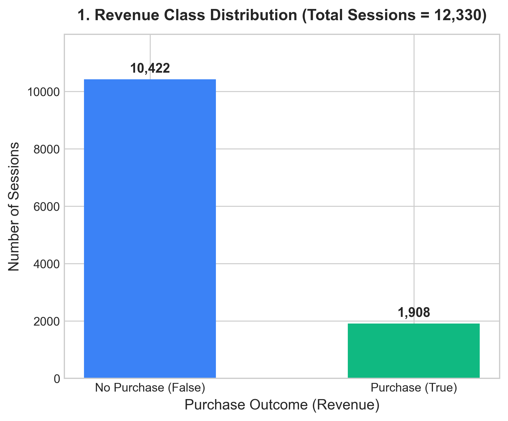 | 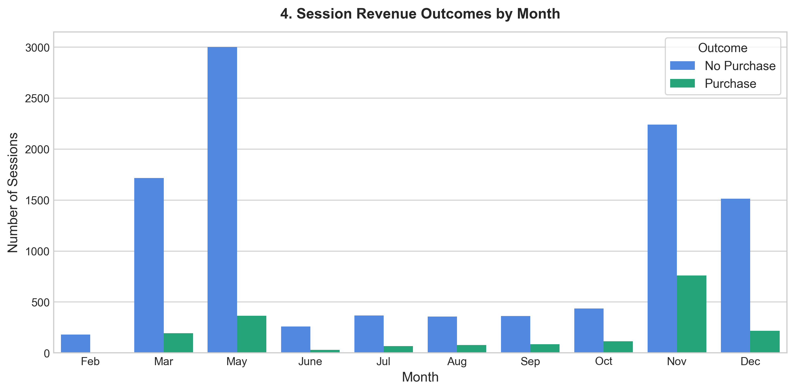 |
| **`PageValues` Distribution (Dominant Predictor)** | **Pearson Correlation Heatmap (Numerical Features)** |
| 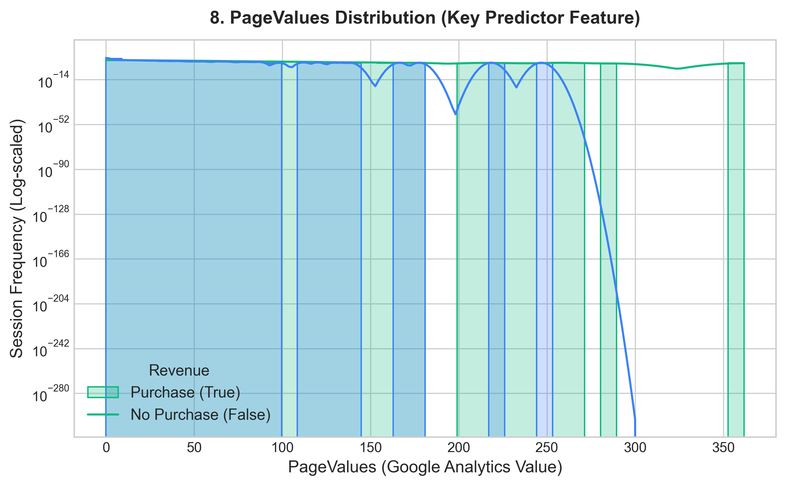 | 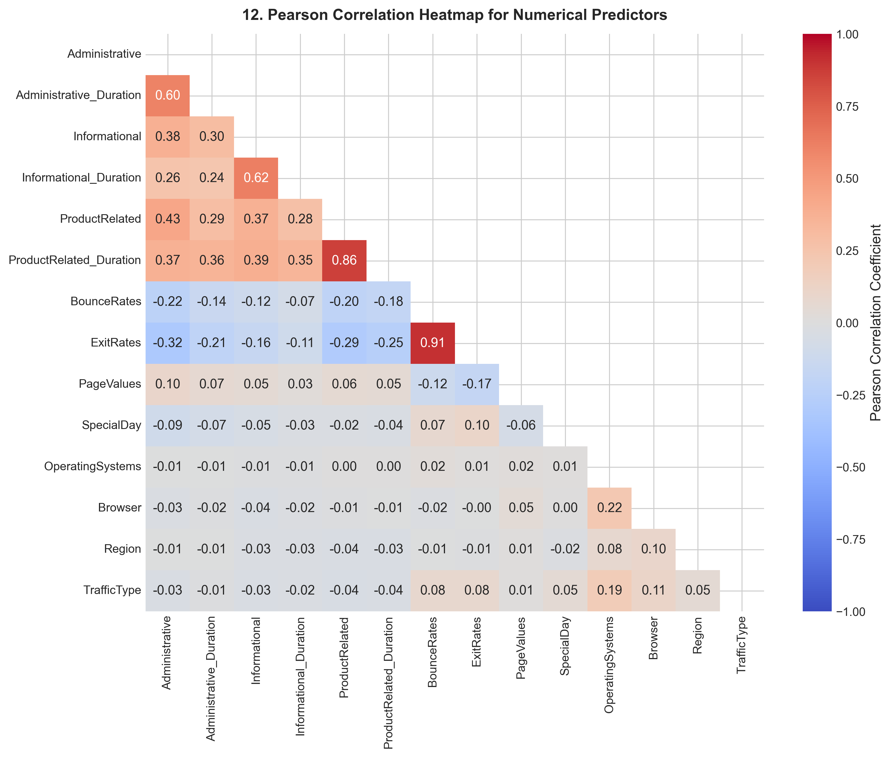 |

---

## 📈 Consolidated 5-Model Quantitative Results

### 1. Supervised Classification Models (Evaluated on Held-Out Test Set, $N = 2,466$)

| Model | Optimal Configuration | 5-Fold CV F1 | Test Accuracy | Test Precision | Test Recall | Test F1-Score | Test ROC-AUC | Test PR-AUC |
| :--- | :--- | :---: | :---: | :---: | :---: | :---: | :---: | :---: |
| **Random Forest** | `n_estimators=100, max_depth=12, min_samples_leaf=5, max_features=0.5, class_weight='balanced'` | **0.6837** | **0.8849** | 0.6068 | 0.7513 | 0.6713 | **0.9320** | **0.7398** |
| **Logistic Regression** | `C=0.01, penalty='l1', solver='saga', SMOTE-in-CV` *(V7 tuned threshold = 0.57; V5 default CV F1 = 0.6698)* | 0.6739 | — | **0.6113** | 0.7618 | **0.6783** | 0.9205 | 0.6783 |
| **Decision Tree** | `max_depth=3, criterion='entropy', class_weight='balanced'` *(Individual Notebook)* | ~0.6600 | 0.8750 | 0.5710 | **0.8120** | 0.6700 | 0.9080 | — |
| **Support Vector Machine** | `kernel='rbf', C=100.0, gamma=0.001, class_weight='balanced'` | 0.6655 | 0.8747 | 0.5759 | 0.7251 | 0.6419 | 0.8997 | — |
| **Decision Tree (Depth-7 Baseline)** | `max_depth=7, criterion='gini', class_weight='balanced'` *(Backend Comparison Pipeline)* | 0.6344 | 0.8500 | 0.5098 | **0.8194** | 0.6285 | 0.8928 | — |

**Key Takeaways Across Supervised Models**:
- **Best Overall Ranking & Probability Calibration**: **Random Forest** achieves the highest **ROC-AUC (`0.9320`)**, **PR-AUC (`0.7398`)**, **Accuracy (`88.49%`)**, and **5-Fold CV F1 (`0.6837`)**.
- **Best Threshold-Tuned F1 & Precision**: **Logistic Regression** with L1 sparsity, in-fold SMOTE, and probability threshold tuning (`0.57`) reaches **Test F1 = `0.6783`** and **Precision = `0.6113`**.
- **Best Buyer Sensitivity (Recall)**: **Decision Tree** captures **81.2%–81.9% of all true buyers**, making it ideal when missing a potential customer is much costlier than showing a promotional banner.
- **Strong Non-Linear Margin Generalization**: **SVM** achieves **87.47% accuracy** and **0.8997 ROC-AUC**, outperforming deeper unpruned trees on precision (`57.59%`).
- **Dominant Predictor**: Across all supervised models (Gini importance, Permutation importance, and L1 coefficients), **`PageValues`** is the strongest predictor of purchase intention, followed by seasonal indicator **`Month` (November)**, **`ProductRelated_Duration`**, and **`ExitRates` / `BounceRates`**.

#### Supervised Model Visualizations

##### 🌲 Random Forest
| ROC & Precision-Recall Curves (Test Set) | Permutation Feature Importance |
| :---: | :---: |
| 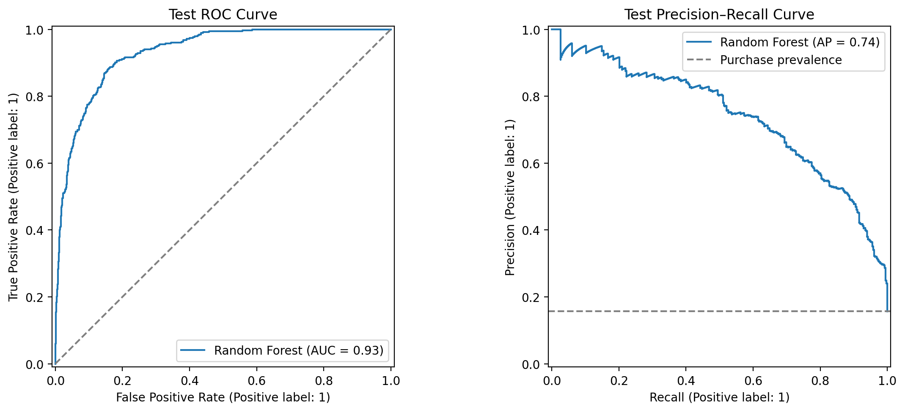 | 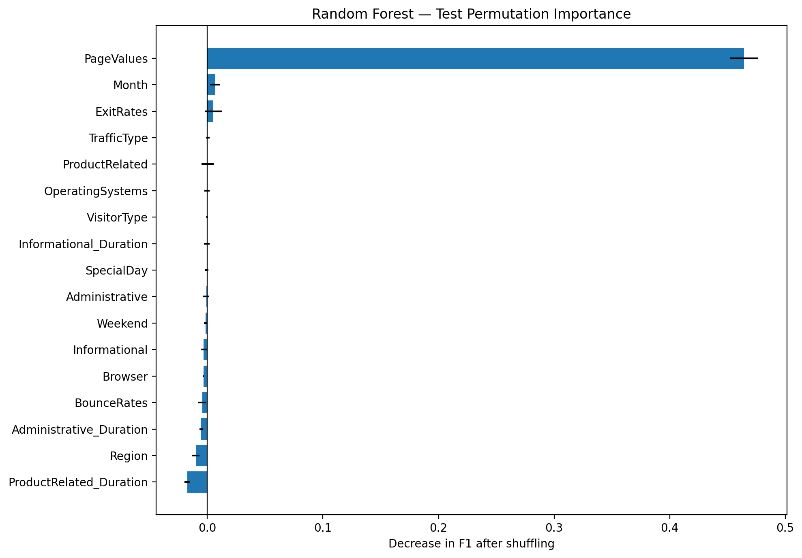 |

##### 📐 Logistic Regression
| Confusion Matrix, ROC & PR Curves (Tuned V7) | Final L1 Model Odds Ratios |
| :---: | :---: |
| 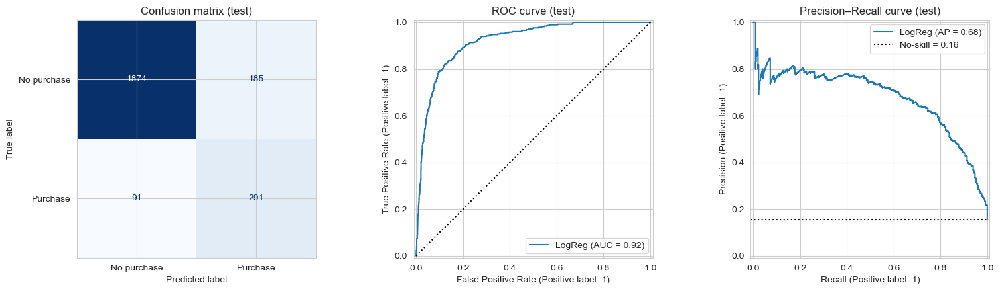 | 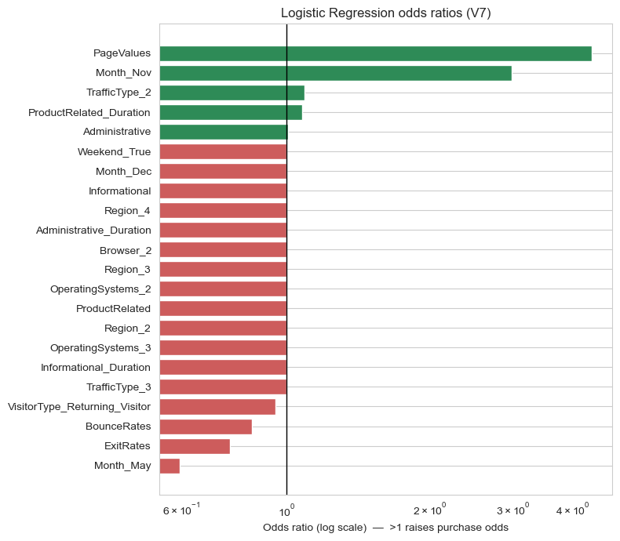 |

##### 🌿 Decision Tree
| Decision Tree Structure (Top 3 Levels) | Overfitting Analysis Across `max_depth` |
| :---: | :---: |
| 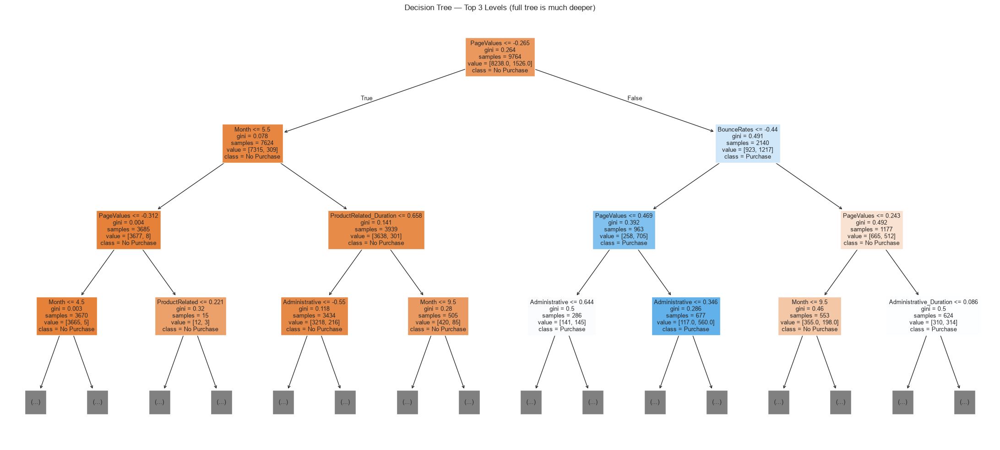 | 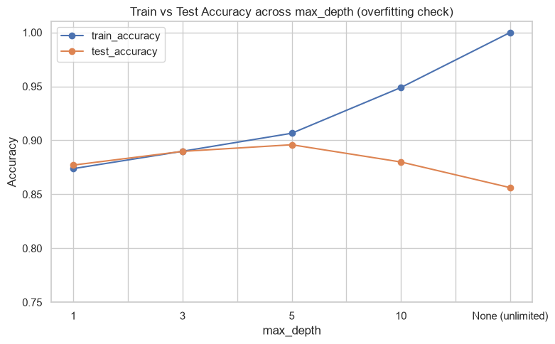 |

##### 🛡️ Support Vector Machine (SVM) & Backend Benchmark
| ROC Curves (`AUC = 0.8997`) | Test Set Confusion Matrices |
| :---: | :---: |
| 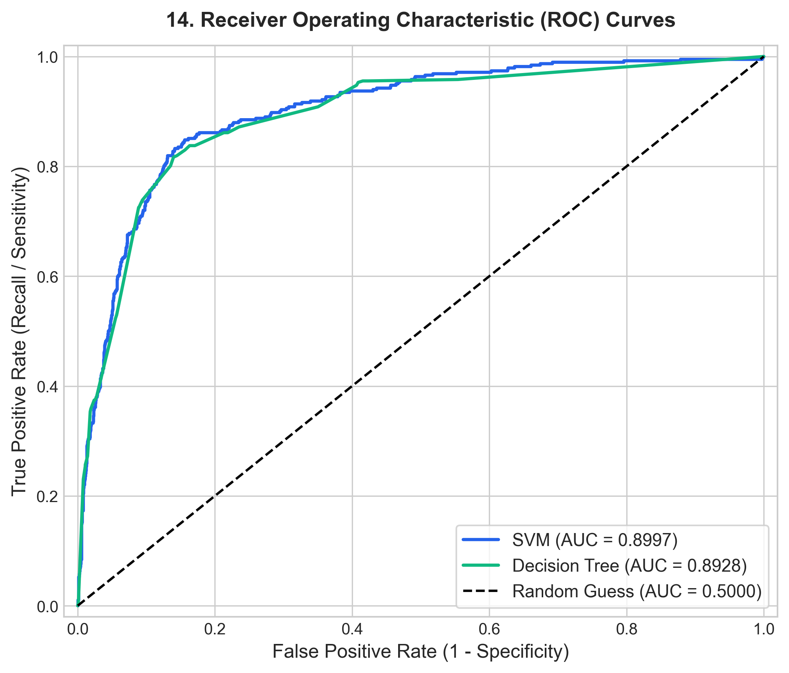 | 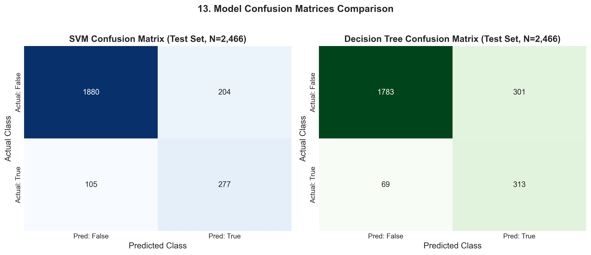 |

---

### 2. Unsupervised Behavioral Segmentation — K-Means + PCA

To segment visitors *before* checkout or page-value accumulation, **K-Means** was trained across 13 preprocessing varieties. The optimal model (**V09: Behavioral features without `PageValues`, log-transformed + `StandardScaler`, $k=3$, `k-means++`**) achieved:
- **5-Fold CV Silhouette Score**: `0.400 ± 0.007`
- **Test Silhouette Score**: `0.4090`
- **Test Davies-Bouldin Index**: `1.0985`
- **Test Calinski-Harabasz Score**: `837.00`

| Cluster ID | Segment Persona | Share of Traffic | Observed Purchase Rate | Behavioral Profile & Recommended Action |
| :---: | :--- | :---: | :---: | :--- |
| **Segment 1** | **Quick Exits** | 7.74% | **0.26%** | Leave after 1–2 pages (`BounceRates ≈ 0.18`, `ExitRates ≈ 0.19`). *Action*: Optimize landing page speed and first-screen value proposition. |
| **Segment 0** | **Casual Browsers** | 74.19% | **14.36%** | Core traffic (~21 product pages, ~13 min duration). *Action*: Trigger personalized product recommendations and urgency reminders. |
| **Segment 2** | **Engaged Shoppers** | 18.08% | **26.53%** | Deep exploration (~85 product pages, ~55 min duration, very low bounce). Converts at **nearly 2× the site average**. *Action*: Streamline checkout, offer live chat assistance, and cart recovery incentives. |

#### K-Means Segmentation Visualizations
| Discovered Shopper Personas & Purchase Rates ($k=3$) | 2D PCA Cluster Projection |
| :---: | :---: |
| 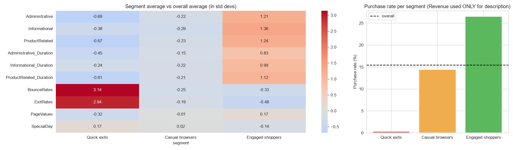 | 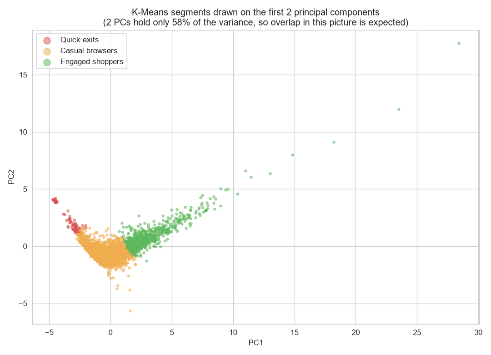 |

---

## 🚀 How to Run the Project

### 1. Environment Setup
```bash
# Install core dependencies
pip install -r requirements.txt
```

### 2. Run the FastAPI Backend Server (`backend/`)
Serves REST endpoints for dataset analytics, model comparison, ROC/PR curves, confusion matrices, and live purchase probability inference:
```bash
uvicorn backend.app.main:app --host 127.0.0.1 --port 8000 --reload
```
- **Interactive Swagger UI**: `http://127.0.0.1:8000/docs`
- **Run Backend Automated Tests**:
  ```bash
  pytest backend/tests/test_backend.py -v
  ```

### 3. Run the Streamlit Shopper Segment Finder App (`deployment/`)
Launches the interactive **PurchaseSense — K-Means Shopper Segment Finder** web application:
```bash
pip install streamlit
streamlit run deployment/app.py
```

### 4. Explore the Jupyter Notebooks
- **Consolidated Project Notebooks**: Open [`notebooks/01_data_understanding.ipynb`](./notebooks/01_data_understanding.ipynb) through [`notebooks/04_model_evaluation.ipynb`](./notebooks/04_model_evaluation.ipynb) or [`google_colab_notebook.ipynb`](./google_colab_notebook.ipynb).
- **Individual Member Notebooks**: Browse [`individual_models/`](./individual_models/) to inspect each student's standalone experiments and tuning logs.

---

## ⚖️ Ethical Considerations & Responsible AI
- **Data Privacy**: The dataset comprises anonymous session-level telemetry with zero Personally Identifiable Information (PII). Real-world deployments must respect GDPR/ePrivacy consent.
- **Fairness & Non-Discrimination**: Proxies such as `Region`, `Browser`, or `OperatingSystems` must not be used for discriminatory pricing or service throttling.
- **Imbalance Mitigation**: Using `class_weight='balanced'` and in-fold `SMOTE` prevents minority-class buyers from being statistically ignored.
- **Human-in-the-Loop**: Predicted probabilities (`predict_proba`) and segment assignments are decision-support heuristics that should complement human merchandising judgment.
